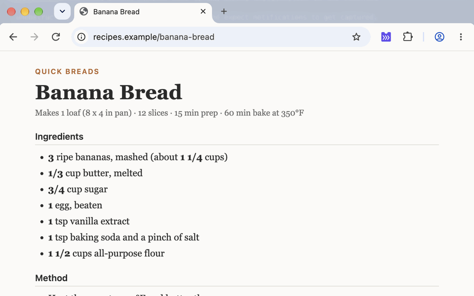
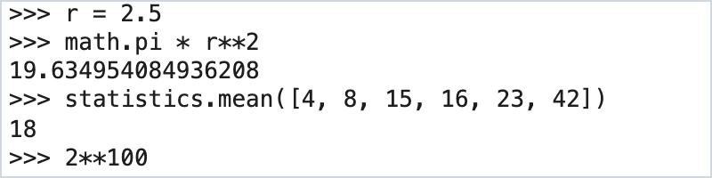
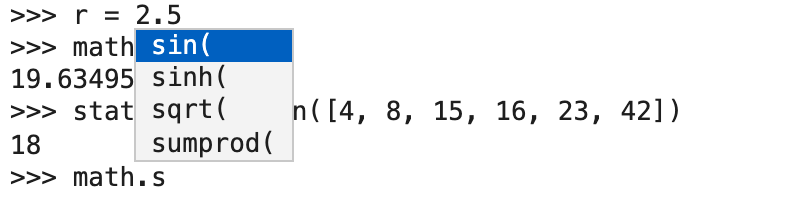

# Python REPL (Chrome Extension)

A Chrome extension that puts an offline Python 3.14 REPL in your toolbar
for quick arithmetic without the need to switch tabs or windows.



<picture>
  <source media="(prefers-color-scheme: dark)" srcset="docs/screenshots/session-dark.png">
  
</picture>
<picture>
  <source media="(prefers-color-scheme: dark)" srcset="docs/screenshots/completion-dark.png">
  
</picture>

Runs CPython 3.14 compiled to WebAssembly (Pyodide 314.0.7) with `math`,
`random`, and `statistics` pre-imported:

- **Familiar console UX:** Standard `>>>` / `...` prompts, CPython tracebacks,
  and Tab completion with a live-filtering popup menu (similar to IPython).
- **Persistent across popups:** Variables and scrollback live in a hidden
  offscreen document, so closing and reopening the popup picks up right where
  you left off. State resets when the browser restarts.
- **Minimal footprint:** Bundles only the standard library modules required for
  the console and the three pre-imported modules. No third-party packages and no
  `micropip`.
- Instant, responsive UI.

See [`docs/protocol.md`](docs/protocol.md) for the internal message protocol.

## Build

Requires [`uv`](https://docs.astral.sh/uv/) and Node.js (for `make test`).

```sh
make vendor   # Download pinned Pyodide release, verify SHA-256, and write trimmed bundle to vendor/pyodide/
make icons    # Generate icons/icon{16,48,128}.png via scripts/gen_icons.py (stdlib only)
make test     # Run Node test suite against the trimmed bundle
make zip      # Package runtime files into dist/python-repl-<manifest version>.zip
make screenshots  # Regenerate the light/dark popup-only images in docs/screenshots/ (uses the smoke-test Chrome)
make store-assets # Regenerate the Chrome Web Store screenshots and promo tile in docs/store/
make demo-gif     # Re-record docs/demo.gif from the real browser window
make demo-video   # Build dist/demo.mp4 (1920x1080, for YouTube) from the last demo-gif recording
```

`make demo-gif` and the screenshots from `make store-assets` capture the real
Chrome for Testing window, toolbar, and popup with `screencapture`, so they
need macOS, the **Screen Recording** permission for your terminal, and an
unobstructed screen while they run (don't use the mouse or keyboard). Key
presses are sent through Puppeteer, and the popup is opened with
`chrome.action.openPopup()`, so the Accessibility permission isn't needed. The
key captions in the GIF are added afterwards. The background page is a local
fixture (`scripts/demo-page.html`). The demo starts from a fresh profile, so
the popup shows the real first-open banner; the video uses the same frames at
full resolution, padded to 16:9.

Chrome Web Store listing text, privacy answers, and the submission checklist
are in [`docs/store-listing.md`](docs/store-listing.md).

`vendor/`, `dist/`, and `.cache/` are generated at build time and gitignored.

## Install (Unpacked)

1. Run `make vendor icons`.
2. Open `chrome://extensions` and enable **Developer mode** (top right).
3. Click **Load unpacked** and select the repository root (containing
   `manifest.json`).
4. Pin **Python REPL** from the toolbar's puzzle-piece menu and click it to
   open.

After modifying source files, click the reload icon on the extension card in
`chrome://extensions`. Requires Chrome 116 or later.

**Hotkey:** `Alt+Shift+P` (`Option+Shift+P` on macOS) opens the popup. Chrome
only binds suggested shortcuts on fresh installs and skips them if there is a
conflict. You can view or customize the binding at
`chrome://extensions/shortcuts`.

## Keyboard Shortcuts

On macOS, `Ctrl` shortcuts use the `Control` key (not `Command`), except where
noted.

| Key | Behavior |
|---|---|
| `Enter` | Submit the current line, or continue with `...` if the statement is incomplete. |
| `Tab` | Complete identifier. Inserts immediately on a single match; inserts the common prefix and opens the completion menu on multiple matches. Indents when pressed on a blank line. |
| Typing (menu open) | Filters completions by prefix; `Backspace` widens the filter. Typing a non-identifier character (`(`, space, operator) inserts it and closes the menu. |
| `↓` / `↑` (menu open) | Cycle through completion candidates (wraps around). |
| `Tab` / `Enter` / `→` (menu open) | Insert the selected candidate and close the menu without submitting the line. Clicking a candidate with the mouse does the same. |
| `Esc` (menu open) | Dismiss the completion menu without inserting. |
| `↑` / `↓` | Navigate input history (when the completion menu is closed). |
| `Ctrl-L` | Clear the screen while preserving variables and history. |
| `Cmd-C` (macOS) / `Ctrl-Shift-C` | Copy the selected text, or copy the last output verbatim (including quotes on strings) if nothing is selected. |
| `Ctrl-D` (empty line), `exit()`, `quit()` | Reset the session: restart the interpreter and clear both the transcript and history. |
| `Ctrl-C` (idle) | Discard the current input line and any pending multi-line block (`KeyboardInterrupt`). |
| `Ctrl-C` (running) | Raise `KeyboardInterrupt` in running code while keeping defined variables. If execution does not halt within 1 second (e.g., inside a blocking C call), the worker restarts and session state is cleared. |

## Privacy

- **Zero network access:** Pyodide and the trimmed standard library are bundled
  locally—nothing is fetched from a CDN, and dynamic package loading
  (`loadPackage`, `micropip`) is disabled. The Content Security Policy restricts
  `connect-src` to the extension origin, blocking even direct `js.fetch` calls
  from Python (verified by the smoke test).
- **Minimal permissions:** Requests only the `offscreen` permission. With no
  host permissions, content scripts, or access to tabs, history, or cookies, the
  extension cannot read or interact with web pages.
- **Ephemeral state:** Nothing is written to `chrome.storage` or disk. Session
  state lives strictly in memory and disappears on reset or browser restart.

The privacy policy for the store listing is [`PRIVACY.md`](PRIVACY.md).

## Chrome Smoke Test

```sh
make smoke
```

Launches Chrome for Testing via Puppeteer with the unpacked extension loaded,
then drives `popup.html` as a tab to verify:

- Startup snapshot, banner, and basic evaluation
- Tab completion menu (live filtering and accepting with `Enter` without
  submitting)
- `Ctrl-C` interrupts (one, then 20 in a row with no restart fallback) and
  `crossOriginIsolated` state in the offscreen document
- State persistence across popup close/reopen and warm-open latency
- CSP-blocked network fetches, disallowed imports, output size caps, `Ctrl-L`,
  and `exit()`

Puppeteer and Chrome for Testing (~600 MB) are installed locally into
`.cache/chrome-test/` from `tests/chrome-smoke.package.json`—nothing is
installed globally. Chrome for Testing is required because branded Google Chrome
disables `--load-extension`. Run `SMOKE_HEADFUL=1 make smoke` to watch the
browser window.

Because automated tests cannot click the browser toolbar button or measure real
click-to-popup latency, see
[`docs/manual-test-checklist.md`](docs/manual-test-checklist.md) for manual
verification steps.

## Upgrading Pyodide

1. Update `PYODIDE_VERSION` and `TARBALL_SHA256` (the SHA-256 of
   `pyodide-core-<version>.tar.bz2` from the Pyodide GitHub release) in
   `scripts/fetch_pyodide.py`.
2. Fetch the **untrimmed** standard library and trace which modules the console
   loads:
   ```sh
   make clean-vendor
   uv run scripts/fetch_pyodide.py --untrimmed
   PYODIDE_TRACE_MODULES=1 node --test tests/
   ```
   This logs every stdlib file imported while exercising the console,
   completions, tracebacks, and pre-imported modules.
3. Add any newly required modules to `STDLIB_ALLOWLIST` in
   `scripts/fetch_pyodide.py`.
4. Rebuild the trimmed bundle and run the full test suite:
   ```sh
   make clean-vendor vendor test smoke
   ```
5. If the Python minor version changed, update `BANNER_PREFIX` in
   `tests/chrome-smoke.mjs`, update the version numbers in this README, and
   review `docs/pyodide-notes.md` against the new release.

## License

MIT (see [`LICENSE`](LICENSE)).

Built artifacts (`vendor/pyodide/` and `dist/*.zip` produced by `make zip`)
bundle third-party software downloaded at build time and not committed to this
repository: Pyodide (MPL-2.0), CPython and its standard library (PSF License),
and the libraries compiled into `pyodide.asm.wasm` (Emscripten, musl, LLVM
libc++/compiler-rt, libffi, zlib, bzip2, XZ, Zstandard, SQLite, HACL\*, and
others). The release tarball ships no license files, so `make vendor` also
downloads the upstream license texts, pinned to the revisions that Pyodide
release was built from and SHA-256 verified (`NOTICES` in
`scripts/fetch_pyodide.py`), and writes them to
`vendor/pyodide/THIRD_PARTY_NOTICES.txt`. `make zip` places that file and this
project's `LICENSE` at the root of the package.
